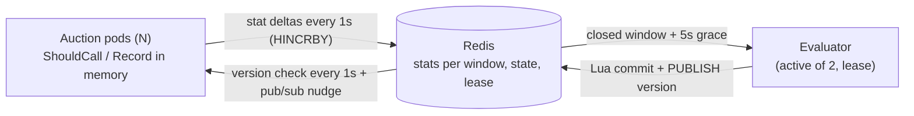

# Design

## Components and flow

- **`policy`**: the rules as one pure function, `Evaluate(prev, windowStats, cfg) → next`. No I/O, no clock, so every rule is a table test.
- **`throttler`** (inside every auction pod): `ShouldCall` and `Record`, plus a flusher and a syncer goroutine.
- **`evaluator`**: once per window, after a grace period, reads the closed window's stats, applies `policy` to every buyer and commits.
- **`store`**: small interfaces with a Redis implementation and an in-memory one for tests; both pass the same conformance suite.

**Stats flow up.** `Record` increments per-buyer atomic counters. Every second the flusher swaps them to zero and sends one `HINCRBY` batch (MULTI/EXEC) into the hash of the window the counts belong to. Windows are epoch-aligned, so every pod buckets identically and Redis sums them. Redis load scales with pods × buyers, not with request rate.

**State flows down.** The evaluator writes every buyer's record, `last_window` and a new `version` in one Lua script, which also publishes the version. Pods poll the version every second (one small read) and load the full state only when it changed; the pub/sub message triggers that check immediately. Measured in the e2e tests: all pods serve a new version within about 8 ms.

## Keeping the per-request check fast

`ShouldCall` reads an immutable `map[buyer]rate` through an `atomic.Pointer` and skips with probability `rate`. The syncer builds a new map and swaps the pointer, so the request path has no network call, no lock and no allocation: about 16 ns. `Record` is one map load and one atomic add. Metrics are updated by the flusher, off the request path.

## Consistency across pods

- **One writer, one sum.** Only the evaluator writes state, and all pods add into the same window hash, so every pod converges on the same state within about a second.
- **One active evaluator.** Replicas compete for a Redis lease (`SET NX PX`, renewed every second). Failover takes at most the lease TTL (15s).
- **Exactly once per window.** The commit script refuses any window not newer than `last_window`, so even a split brain cannot apply a window twice.
- **Late stats.** The evaluator reads a window 5s after it closes (`THROTTLE_GRACE`). Pods retry failed flushes until that point, then drop and count the stats instead of writing them where nobody will read them.
- **Misconfiguration is visible.** Records carry the evaluator's window size; a pod with a different `THROTTLE_WINDOW` logs an error and exports `throttle_config_mismatch`. Pods export the state's age, and alert rules cover both.

## Decisions where the spec is silent

| Case | Decision | Why |
| --- | --- | --- |
| Window below minimum sample during recovery | Neutral: rate and reason held | Silence is not evidence of health; recovering on it could unblock a buyer that is down |
| Blocked buyer with low traffic | Stays blocked: at 0.95 only 5% of calls are made, so a buyer needs about 2,000 requests per window (33/s cluster-wide) to reach the 100-call sample. Opt-in `THROTTLE_STALE_RECOVERY_WINDOWS=N` takes one step after N under-sample windows | Off by default to follow the spec strictly |
| Failures and timeouts | Judged separately; 60% failed + 25% timeouts does not block | The spec gives two thresholds, not a combined error rate |
| "Reaches the threshold" | `>=` | Literal reading |
| Both thresholds broken | Reason `failure_rate` | Fixed order; both rates are logged |
| Violation while blocked | Stays at block level, recovery restarts | "Violation at any point" |
| What counts as a request | Calls actually made; throttled skips are a separate metric | Only real responses say anything about health |
| Evaluator down for several windows | Evaluates only the latest closed window on return | Missed windows are not evidence either way |
| Redis unreachable | Pods keep the last state (fail static); before the first load they call everyone (fail open) | Never block revenue on an infrastructure fault |
| Float drift | Rates rounded to 4 decimals | 0.95 reaches exactly 0 in 10 steps |

## Trade-offs

- **Eventual consistency (about 1s) over per-request coordination.** A strongly consistent check would put Redis on the critical path of every auction.
- **Probabilistic skipping** instead of exact quotas: no shared per-request counters, negligible error at these volumes.
- **Fixed windows** instead of sliding: they match "the last window", make aggregation one `HINCRBY` per field and make "evaluate once per window" well defined.
- **Redis as the only dependency.** It is a single point of failure for updates only; pods keep serving the last state. Keys share a hash tag, so the scripts stay valid on Redis Cluster.
- **At-least-once stats.** A flush whose reply is lost is retried and counted twice; a pod crash loses up to a second of stats. Both are negligible against a window.

**Next steps, not built:** fence commits with a version compare-and-set, so a stalled former leader cannot commit over state it read before a failover; evict buyers that have been open and silent for a long time (state currently only grows); per-buyer policy overrides; a dedicated low-volume policy instead of the opt-in probe.
