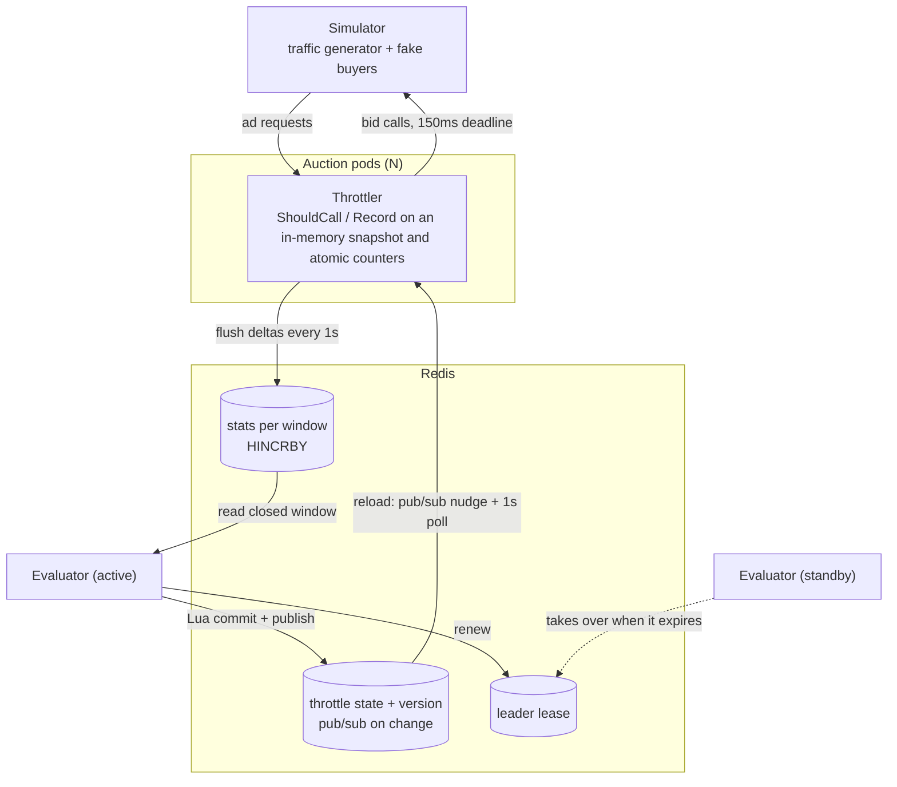
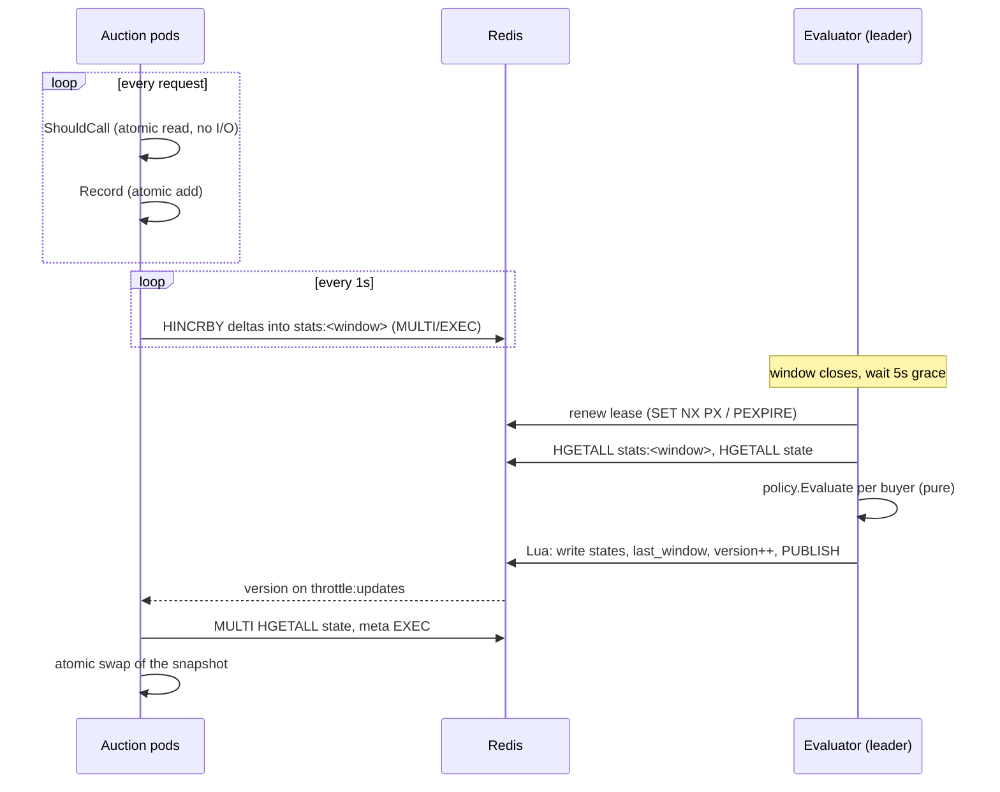
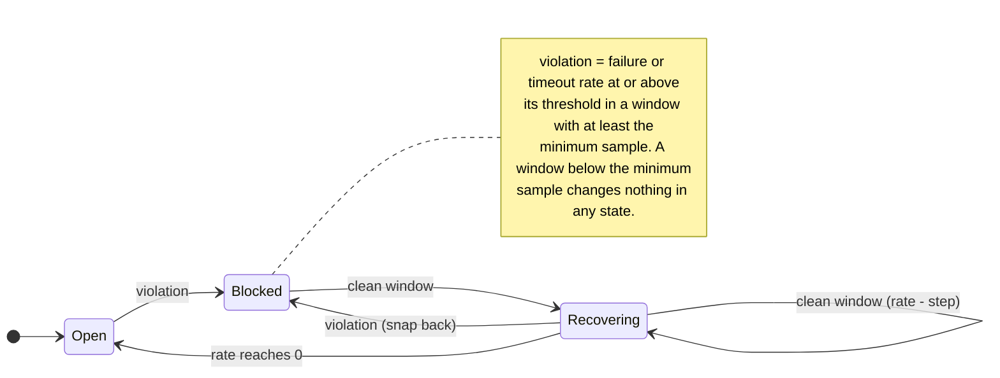

# Design

## Components and flow

One evaluation cycle, end to end:

A buyer's throttle rate over time:

- **`policy`**: the rules as one pure function, `Evaluate(prev, windowStats, cfg) → decision`. No I/O, no clock.
- **`throttler`** (inside every auction pod): `ShouldCall` and `Record`, plus a syncer and a flusher goroutine.
- **`evaluator`**: on each window boundary + grace period, reads the closed window's stats, applies `policy`, commits.
- **`store`**: small interfaces (`StatsSink`, `StatsSource`, `StateReader`, `StateWriter`, `Leaser`). `redisstore` for production, `memstore` for tests; both pass the same conformance suite.

**Stats flow up.** `Record` increments per-buyer atomic counters. Each second the flusher swaps them to zero and sends one `HINCRBY` batch, wrapped in MULTI/EXEC so a failed flush applies nothing and its retry cannot double count, into the hash of the window those counts belong to (windows are epoch-aligned, so every pod buckets identically). Redis load scales with pods × buyers, not with request rate.

**State flows down.** The evaluator writes every buyer's record, `last_window` and a new `version` in one Lua script, which also publishes the version. Pods reload on that message and also poll every second, so a lost message costs at most a second. Measured in the e2e tests: all pods serve a new version within about 8 ms with pub/sub, and within one poll interval without it.

## Keeping the per-request check fast

`ShouldCall` reads an immutable `map[buyer]rate` through an `atomic.Pointer`. The syncer builds a new map and swaps the pointer, so readers never lock. Open buyers return without drawing a random number. There is no network call, no mutex and no allocation: about 16 ns/op in the parallel benchmark. `Record` is one `sync.Map` load and one atomic add (about 15 ns/op). Metrics are updated by the flusher, not on the request path.

## Consistency across pods

- **One writer, one sum.** Only the evaluator writes state; all pods add into the same window hash. Every pod therefore sees the same state, at most ~1s late (1-2% of a 60s window).
- **One active evaluator.** Replicas compete for a Redis lease (`SET NX PX`, renewed each second, released on shutdown). Failover takes at most the lease TTL (15s), or about a second after a clean shutdown.
- **Exactly-once per window.** The commit script refuses a window that is not newer than `last_window`, so even a split brain cannot apply a window twice.
- **Late stats.** A window is evaluated only after a grace period (default 5s, longer than the flush interval plus clock skew).
- **Same windows everywhere.** The evaluator stamps its window size on every record. A pod configured with a different `THROTTLE_WINDOW` logs an error and sets `throttle_config_mismatch`, since its stats would land in windows the evaluator never reads.
- **Stale state is visible.** Pods export `throttle_state_age_seconds` and warn once when nothing has been committed for three windows (for example every evaluator is down). They keep serving the last state meanwhile.

## Decisions where the spec is silent

| Case | Decision | Why |
| --- | --- | --- |
| Window below minimum sample during recovery | Neutral: rate and reason held | Not evidence of health; recovering on silence could unblock a buyer that is down |
| Low-volume buyer stuck blocked (5% of a small volume never reaches 100) | Opt-in `THROTTLE_STALE_RECOVERY_WINDOWS=N`: after N under-sample windows in a row, take one step | Off by default to follow the spec strictly; available when operators prefer probing |
| "Reaches the threshold" | `>=` | Literal reading of "reaches" |
| Both thresholds broken | Reason `failure_rate` | Fixed rule order; both rates are logged |
| Violation while already blocked | Stays at block level, reason refreshed, recovery restarts | Same rule as "violation at any point" |
| Float drift in steps | Rates rounded to 4 decimals | 0.95 reaches exactly 0 in exactly 10 steps |
| Block level lowered by config | Current rate clamped to the new level | The rate must never exceed the block level |
| Buyer with no traffic in a window | Evaluated as an empty window (held) | Buyers come from the window's stats plus the existing state |
| What counts toward stats | Only calls actually made; throttled skips are a separate metric | The evaluator judges the buyer on real responses |
| Evaluator down for several windows | Evaluates only the latest closed window on return | Missed windows are not evidence either way |
| Unknown result value passed to `Record` | Counted as `failed` | A caller bug should look unhealthy, not healthy |
| Redis unreachable | Pods keep last known state (fail static) and retry flushes for one window; before the first load they fail open | Old health data beats none; never blocking revenue on an infrastructure fault |
| Auction caller abandons the request | Calls cut short are not recorded | Not the buyer's fault |

## Trade-offs

- **Eventual consistency (~1s) over per-request coordination.** A strongly consistent check would put Redis on the critical path of every auction.
- **Probabilistic skipping** (`rand < rate`) instead of exact quotas: no shared counters per request, and per-pod error is negligible at these volumes.
- **Fixed windows** instead of sliding: they match the spec ("last window"), make aggregation a single `HINCRBY` per field, and make "one evaluation per window" well defined. A burst straddling a boundary is split across two windows.
- **Redis as the only dependency.** It provides atomic counters, a state hash, pub/sub and a lease. One Redis is a single point of failure for *updates* only; pods keep serving from the last snapshot. Production would use a replicated Redis; keys share a hash tag so the Lua scripts remain valid on Redis Cluster.
- **Up to 1s of a pod's stats can be lost** on a crash (graceful shutdown flushes). Negligible against a window of thousands of calls.

Not built, but natural next steps: per-buyer policy overrides, alert rules on `throttle_state_age_seconds` and `throttle_config_mismatch`, and a separate low-volume policy instead of the opt-in probe.
