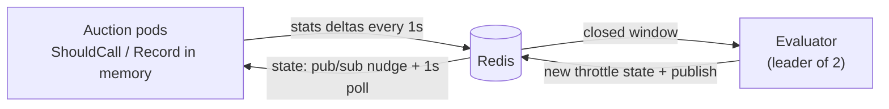

# Buyer Throttling Service

Monitors the health of external buyers in a real-time auction platform and controls how much traffic each one receives. A bad buyer is blocked down to 5% of its traffic, then recovers in 10% steps once it is healthy again.

Written in Go. Redis is the only dependency. Design notes, diagrams and the decisions behind them are in [DESIGN.md](DESIGN.md).

## Review in 5 minutes

1. **See it work:** `make demo-verify` starts the whole system, waits until every buyer has done what [`deploy/scenario.yaml`](deploy/scenario.yaml) says it should (blocked, snapped back, recovered, or never throttled), checks that all pods converged, and tears it down. About 4 minutes; CI runs it on every push.
2. **The decisions:** the table in [DESIGN.md](DESIGN.md#decisions-where-the-spec-is-silent) covers every case the spec left open.
3. **The rules:** [`internal/policy/policy.go`](internal/policy/policy.go) is one pure function, `Evaluate`, with its table tests, a multi-window scenario and property tests next to it.
4. **The hot path:** `ShouldCall` and `Record` in [`internal/throttler/throttler.go`](internal/throttler/throttler.go). No I/O, no locks, no allocations, about 16 ns.
5. **The distributed parts:** [`internal/evaluator/evaluator.go`](internal/evaluator/evaluator.go) (lease, exactly-once commits) and [`internal/e2e/live_test.go`](internal/e2e/live_test.go), which proves pod convergence, leader crash failover and Redis outage behaviour in real time against Redis.



## Run the demo

Requirements: Docker with Compose v2. `jq` is optional (used by `make demo-logs`).

```sh
docker compose up --build        # or: make demo && make demo-logs
```

This starts:

| Service | What it is | Port |
| --- | --- | --- |
| `redis` | Shared store | 6379 |
| `evaluator-1`, `evaluator-2` | Evaluator replicas; one holds the lease, the other is a hot standby | 8080, 8081 |
| `auction-1..3` | Auction pods using the throttler | 8091-8093 |
| `simulator` | Fake buyers plus a traffic generator (800 ad requests/s) | 9000 |

The demo uses a **10s window** so a full block-and-recover cycle takes about 2-3 minutes. The scenario in [`deploy/scenario.yaml`](deploy/scenario.yaml) plays out by itself:

| Buyer | Behaviour | What you should see |
| --- | --- | --- |
| `buyer_bad` | 90% failures for 45s, then healthy | Blocked on `failure_rate`, held while still failing, then 0.85 → 0.75 → … → 0 |
| `buyer_slow` | 50% of responses slower than the 150ms deadline for 60s | Blocked on `timeout_rate`, then recovers |
| `buyer_relapse` | Fails, recovers for 50s, fails again for 20s | Snaps back from mid-recovery straight to 0.95 |
| `buyer_flaky` | 50% failures forever | Never blocked (below the 0.7 threshold) |
| `buyer_tiny` | 100% failures, ~4 requests/s | Never blocked (below the 100-request minimum sample) |
| `buyer_healthy_1/2` | Healthy | Never throttled |

### Watching it

Evaluator decisions (one JSON line per buyer per window while it is throttled or changes):

```sh
docker compose logs -f evaluator-1 evaluator-2     # raw JSON
make demo-logs                                     # condensed, needs jq
```

Excerpt from a real run (condensed by `make demo-logs`):

```
11:42:14 acquired leadership evaluator-1
11:42:25 buyer blocked                         buyer_bad        rate 0->0.95    failure_rate n=1128  fail=0.906 timeout=0
11:42:25 buyer blocked                         buyer_relapse    rate 0->0.95    failure_rate n=1128  fail=0.89  timeout=0
11:42:25 buyer blocked                         buyer_slow       rate 0->0.95    timeout_rate n=1075  fail=0     timeout=0.434
11:42:35 buyer still violating, stays blocked  buyer_bad        rate 0.95->0.95 failure_rate n=4482  fail=0.898 timeout=0
11:43:15 buyer recovering                      buyer_bad        rate 0.95->0.85 recovering   n=404   fail=0.045 timeout=0
11:43:25 buyer recovering                      buyer_bad        rate 0.85->0.75 recovering   n=765   fail=0.009 timeout=0
11:43:45 buyer recovering                      buyer_relapse    rate 0.45->0.35 recovering   n=3899  fail=0.456 timeout=0
11:43:55 buyer blocked                         buyer_relapse    rate 0.35->0.95 failure_rate n=4794  fail=0.9   timeout=0
...
11:44:45 buyer fully recovered                 buyer_bad        rate 0.05->0                 n=7146  fail=0.008 timeout=0
(evaluator-1 stopped)
11:45:58 acquired leadership evaluator-2
```

Other views:

- **Authoritative state**: `curl localhost:8080/state` (the evaluator reads it from Redis).
- **Each pod's own view**: `curl localhost:8091/state` (and 8092, 8093). The `version` matches across pods within about a second.
- **Traffic side**: the simulator logs a `traffic summary` every 10s with, per buyer, how many requests were called and how many were throttled (`skipped_ratio` ≈ the throttle rate).
- **Pods**: each logs `throttle state updated` with the throttled buyers whenever it loads a new version.

### Breaking a buyer on demand

```sh
curl -X PUT localhost:9000/buyers/buyer_healthy_1 -d '{"failure_rate":0.95}'   # override
curl localhost:9000/buyers                                                   # current behaviour of all buyers
curl -X DELETE localhost:9000/buyers/buyer_healthy_1                          # back to the scenario
```

### Failover

```sh
docker compose stop evaluator-1     # evaluator-2 logs "acquired leadership" and carries on
```

### Metrics and dashboard (optional)

```sh
docker compose --profile observability up --build
```

Prometheus on http://localhost:9090 and a provisioned Grafana dashboard on http://localhost:3000 (anonymous access) showing throttle rate, failure and timeout rates, calls and throttled requests per buyer, each pod's view and the current leader.

Besides `throttle_rate` and the per-buyer call, throttled, failure and timeout series, pods export `throttle_state_age_seconds` and `throttle_config_mismatch`.

**Alerts.** [`deploy/alerts.yml`](deploy/alerts.yml) is loaded by Prometheus in this profile (see http://localhost:9090/alerts; no Alertmanager is wired up):

| Alert | Fires when |
| --- | --- |
| `ThrottleStateStale` (critical) | A pod's state is older than three windows: no evaluator is committing, so nobody gets blocked or recovers |
| `ThrottleWindowMismatch` (critical) | A pod's `THROTTLE_WINDOW` differs from the evaluator's, so its stats are missing from decisions |
| `ThrottleEvaluatorNoLeader` (critical) | Evaluators are up but none has held the lease for a minute |
| `ThrottleEvaluatorFailing` (warning) | Window evaluations have been failing for 5 minutes |
| `ThrottleStatsDropped` (warning) | A pod dropped stats after Redis was unreachable for over a window |

The stale threshold scales with the window through `throttle_window_seconds`, so the same rules work for the 10s demo and 1m production windows. `make test-alerts` runs promtool unit tests for each rule ([`deploy/alerts_test.yml`](deploy/alerts_test.yml)), including a normal failover that must not fire, and a Go test fails if an alert reads a metric the code no longer exports.

`make demo-down` stops everything.

### As an acceptance test

```sh
make demo-verify
```

Each buyer in the scenario declares what should happen to it (`expect: [blocked_on_failures, snap_back, recovered]`, `expect: [never_throttled]`, ...). [`cmd/demoverify`](cmd/demoverify/main.go) watches `GET /state` until every expectation holds, fails immediately if a `never_throttled` buyer is ever throttled, then checks that all three pods serve the evaluator's state version. On failure it prints what is still pending and the evaluator logs. CI runs it on every push.

## Configuration

All services read environment variables. The policy variables must be identical for the evaluator and the pods (docker-compose shares them through one anchor).

**Policy** (evaluator and pods)

| Variable | Default | Meaning |
| --- | --- | --- |
| `THROTTLE_FAILURE_THRESHOLD` | `0.7` | Block when failed/total reaches this |
| `THROTTLE_TIMEOUT_THRESHOLD` | `0.3` | Block when timeouts/total reaches this |
| `THROTTLE_MIN_SAMPLE_SIZE` | `100` | Windows with fewer requests never block and never count as clean |
| `THROTTLE_BLOCK_LEVEL` | `0.95` | Throttle rate when blocked (must be < 1) |
| `THROTTLE_RECOVERY_STEP` | `0.1` | Decrease per clean window |
| `THROTTLE_WINDOW` | `1m` (demo: `10s`) | Evaluation window, whole seconds |
| `THROTTLE_STALE_RECOVERY_WINDOWS` | `0` (off) | Optional: after N under-sample windows in a row, take one recovery step |

**Evaluator**

| Variable | Default | Meaning |
| --- | --- | --- |
| `EVALUATOR_GRACE` | `5s` | Wait after a window closes before reading it (> flush interval + clock skew) |
| `EVALUATOR_LEASE_TTL` | `15s` | Leader lease; bounds failover time |
| `EVALUATOR_TICK` | `1s` | How often to check for due windows and renew the lease |
| `EVALUATOR_ID` | hostname | Replica identity in the lease |

**Auction pod**

| Variable | Default | Meaning |
| --- | --- | --- |
| `THROTTLE_FLUSH_INTERVAL` | `1s` | How often stats are pushed to Redis |
| `THROTTLE_SYNC_INTERVAL` | `1s` | How often state is reloaded without a pub/sub nudge |
| `AUCTION_TIMEOUT` | `150ms` | Buyer deadline; a miss is recorded as a timeout |
| `BUYER_BASE_URL` | `http://localhost:9000` | Where buyers are called |

**Common**: `REDIS_ADDR` (`localhost:6379`), `HTTP_ADDR` (`:8080`), `LOG_LEVEL` (`info`; `debug` also logs healthy buyers).

**Simulator**: `SCENARIO` (path to the YAML), `AUCTION_TARGETS` (comma-separated pod URLs), `RPS` (overrides the scenario), `REPORT_EVERY` (`10s`).

Invalid configuration fails at startup with every problem listed at once.

## Using the throttler in an auction service

```go
st := redisstore.New(redisClient, redisstore.Options{})
th := throttler.New(st, st, throttler.Options{Window: time.Minute})
go th.Run(ctx) // loads state, keeps it synced, flushes stats; final flush on shutdown

if th.ShouldCall(buyerID) {
    err := callBuyer(ctx, buyerID)
    th.Record(buyerID, resultOf(err)) // throttler.ResultOK, ResultFailed or ResultTimeout
}
```

## Development

```sh
make test               # everything below, with -race (-short skips the real-time e2e tests)
make test-integration   # conformance suite and live e2e against a real Redis at REDIS_ADDR (flushes it)
make test-alerts        # promtool unit tests for the Prometheus alert rules (Docker)
make demo-verify        # the docker-compose demo as an acceptance test
make fuzz               # fuzz the policy for 30s
make bench              # hot path benchmarks
make lint               # golangci-lint
make cover              # coverage summary
```

| Test layer | Where | Covers |
| --- | --- | --- |
| Policy rules | `internal/policy` | Block on failure and timeout rate, exact thresholds, minimum sample, 10-step recovery, snap-back, under-sample during recovery, the optional probe, a 19-window scenario, config validation |
| Policy properties | `internal/policy/property_test.go` | Random configurations and window histories ([rapid](https://github.com/flyingmutant/rapid)): the rate stays in [0, block level], rises only on a violation, never changes on an under-sample window, drops exactly one step per clean window, and recovery always takes ceil(block / step) clean windows. Plus a native Go fuzz target |
| Store conformance | `internal/store/storetest` | One suite run against `memstore`, Redis via miniredis and a real Redis: concurrent stat sums, window isolation, idempotent commits, pub/sub, lease expiry and takeover |
| Throttler | `internal/throttler` | Fail open before first load, skip ratio within 5 sigma of the rate, 64 goroutines recording concurrently, window bucketing, retry and drop after store failure, fail static on sync errors, final flush on shutdown |
| Evaluator | `internal/evaluator` | Grace period, block-to-recovery across windows, silent buyers, one commit per window, leader-only evaluation, failover, split brain, lease release |
| End to end, simulated time | `internal/e2e/e2e_test.go` | 2-3 real throttlers and an evaluator on one Redis under a fake clock: every pod converges on the same rate through block, recovery and relapse |
| End to end, real time | `internal/e2e/live_test.go` | Real loops on real Redis (miniredis when `REDIS_ADDR` is unset). **Convergence:** after each of 10 commits, all 3 pods serve the new version in about 8 ms with pub/sub and under one poll interval with polling only. **Leader crash:** the leader dies holding its lease; the standby takes over within the lease TTL, applies no window twice and continues the recovery step by step. **Redis outage:** pods keep throttling from the last state, every call recorded during the outage reaches Redis exactly once, and new state arrives after the restart |
| Demo acceptance | `cmd/demoverify` | The full docker-compose system against the scenario's expectations |

Benchmarks on a 4-core cloud VM:

```
BenchmarkShouldCall-4   157004768   15.86 ns/op   0 B/op   0 allocs/op
BenchmarkRecord-4       209042406   14.79 ns/op   0 B/op   0 allocs/op
```

## Layout

```
cmd/evaluator   cmd/auction   cmd/simulator    binaries
internal/policy                                 the rules (pure)
internal/throttler                              ShouldCall / Record, syncer, flusher
internal/evaluator                              scheduling, lease, commit
internal/store{,/redisstore,/memstore,/storetest}
internal/auction  internal/simulator            demo auction and fake buyers
internal/httpapi  internal/metrics  internal/config  internal/app  internal/window  internal/clock
deploy/                                         scenario, Prometheus, Grafana
```

## Beyond the brief, and why

- **Evaluator high availability** with a lease and exactly-once commits: a single evaluator would be a single point of failure for recovery.
- **Fail static and fail open**: an infrastructure fault never blocks traffic, and a Redis outage does not reset what pods know.
- **Pub/sub plus polling**: state reaches pods in milliseconds normally, and within a second if a message is lost.
- **Graceful shutdown flush**: rolling deploys of auction pods lose no stats.
- **Store conformance suite**: the in-memory store used in tests is proven to behave like Redis.
- **Per-pod `/state`**: shows directly that pods converge.
- **Executable demo**: the scenario carries its own expectations and CI checks them against the running system, so the demo cannot silently rot.
- **Window size mismatch guard and state age metric**: the two misconfigurations that would silently corrupt throttling (pods and evaluator disagreeing on windows, or no evaluator running) are detected and exported.
- **Tested alert rules**: metrics only help if someone is told. Five alerts cover the failures that stop throttling from working without any error reaching an auction, and promtool unit tests prove each fires when it should and stays quiet during a normal failover.
- **Atomic stats flush**: MULTI/EXEC means a failed flush applies nothing, so its retry cannot double count.
- **Opt-in stale-recovery probe**: addresses the one real weakness of the neutral under-sample rule (low-volume buyers can stay blocked) without changing the default behaviour.
